<div align="center">

**English** | [Português](README.pt-BR.md)

# Pop Search

**Find videos from X by what you remember of them, on a Windows 98 desktop with a robot that lives in it.**

[](https://github.com/GLavrador/pop-search/actions/workflows/ci.yml)


<a href="https://pop-search-ochre.vercel.app/"></a>

<br><br>

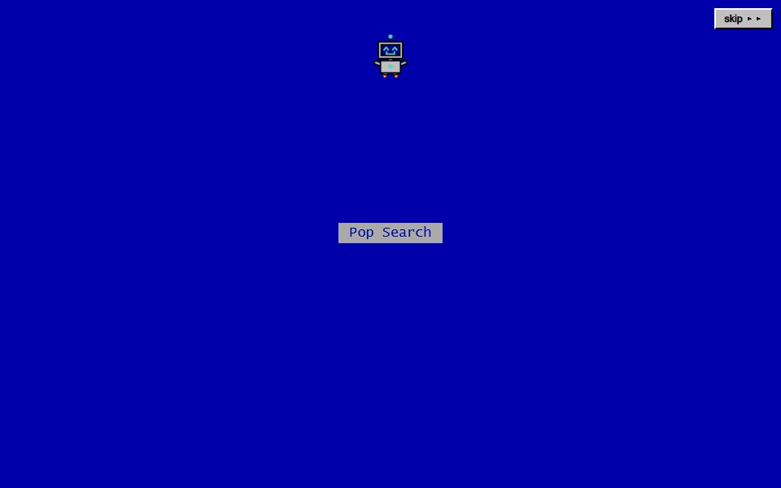

<sub>The first visit in a tab: BIP-98 builds the desktop in front of you, then opens the program. Sped up 1.5x.</sub>

</div>

## What it is

You saw a video on X a while ago. You remember a dog jumping on a green sofa, not the words in the post. Pop Search keeps an archive of videos where an AI watched each one and wrote down what happens in it, and searches that archive by meaning and by exact words at the same time.

The whole thing runs inside a Windows 98 desktop. The guide, the help, the errors and the easter eggs are all delivered by BIP-98, a small robot that lives on that desktop: it explains any control you point at, reacts to what you do, and finds things to do on its own when you stop using the site.

## Try it

Pop Search is up at **[pop-search-ochre.vercel.app](https://pop-search-ochre.vercel.app/)**, and it is the same app I use day to day. Nothing to install.

- **The first visit in a tab** starts with the robot building the desktop, about 20 seconds. Any key or the `skip ▸▸` button jumps straight to the program.
- **Searching needs no account.** Open `Search.exe`, describe the video in your own words, in English or Portuguese, and press `Find Now`.
- **Adding videos needs an account** (an AI analysis uses up quota). You can create one from the `Sign In` tab. Each account has a monthly analysis limit.
- **Not sure where to start?** Take the guide from the invitation above the tabs. It walks through adding and finding a video on practice screens, with no account and no AI call.
- **Then wander.** Double-click the `Tricks` icon for the robot's own list of things to try, and leave the page alone for a little while to see what it gets up to.
- **The interface follows your browser's language**, English or Portuguese, and can be switched in the `Sign In` tab. The pictures here are in English.

## Features

### A guide that uses the real screens

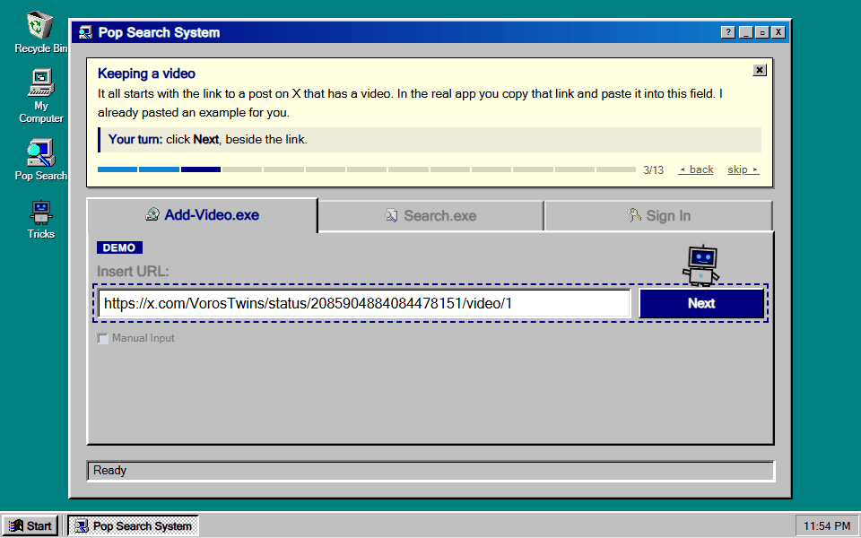

The guide runs on the actual interface with practice data: paste a link, pick what the AI should look at, watch the analysis, review what it wrote and save. Nothing goes into the archive before a person has read and edited it. Sped up 2x.

### Search by what you remember

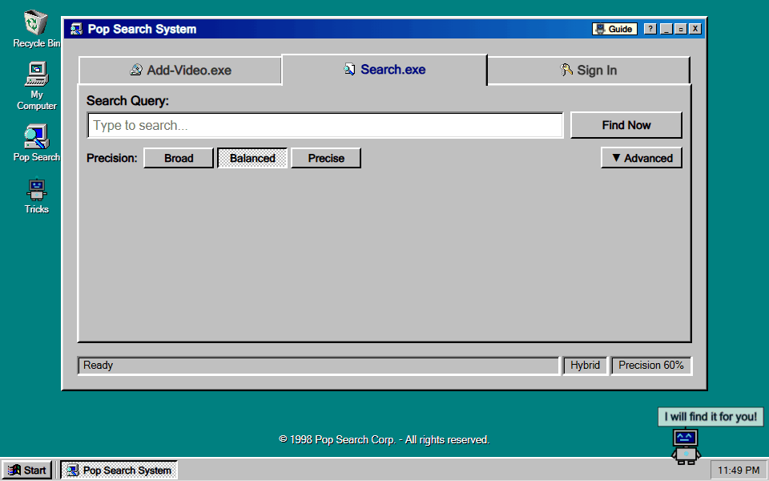

The question is in English and the video description is in Portuguese: no word in common, and it still comes up first. Every result has a `Why?` button that explains, in plain words, where it ranked by meaning and by exact words, and which part of the text matched.

### Adding a video

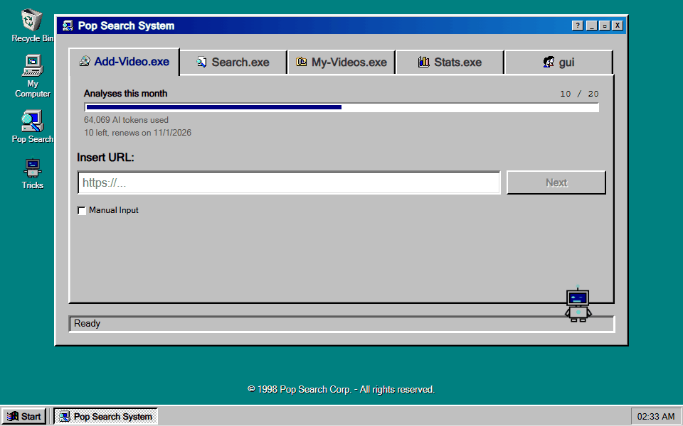

With an account, a video gets into the archive in one of two ways: through the AI analysis, which watches it and writes a draft for a person to review, as in the guide, or by hand, with `Manual Input` checked. The GIF shows the manual way: the link to the post, `Open Form`, a title and a description, then `Save`. Manual entry does not spend an analysis from the quota; only the embedding of the text goes through Gemini. Sped up 1.4x.

### A robot with a life of its own

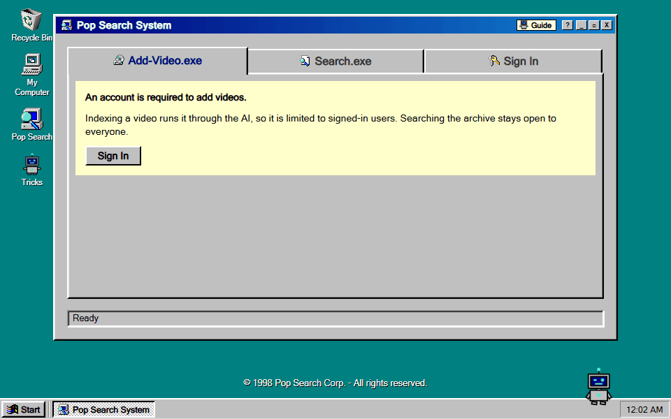

Between your clicks BIP-98 rests on the window, the taskbar or the status bar. Left alone, it goes through a series of small acts, like knocking on the glass, and never while someone is typing, moving the mouse or has a dialog open.

### My Computer shows the real machine

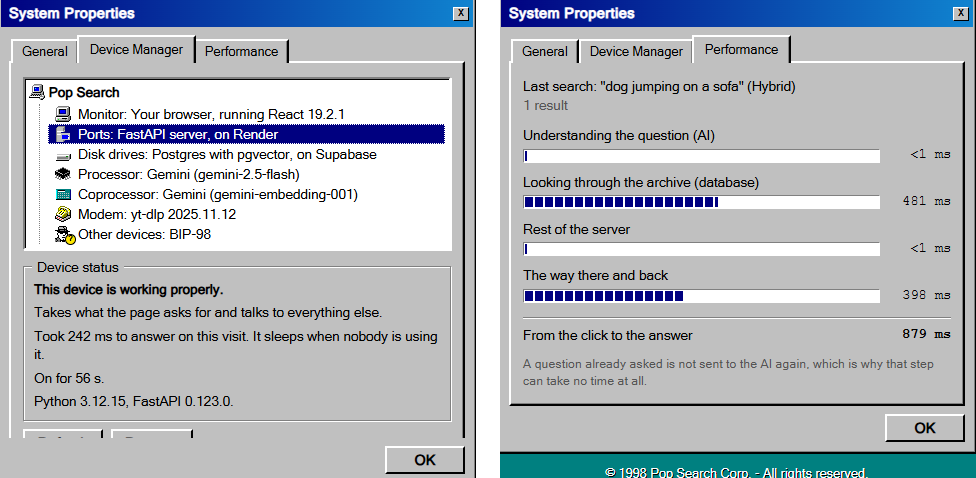

`My Computer` opens System Properties. Device Manager lists the parts the app is actually made of, with live status from the server, and Performance breaks the last search into steps, timed by the server through the `Server-Timing` header.

### On a phone

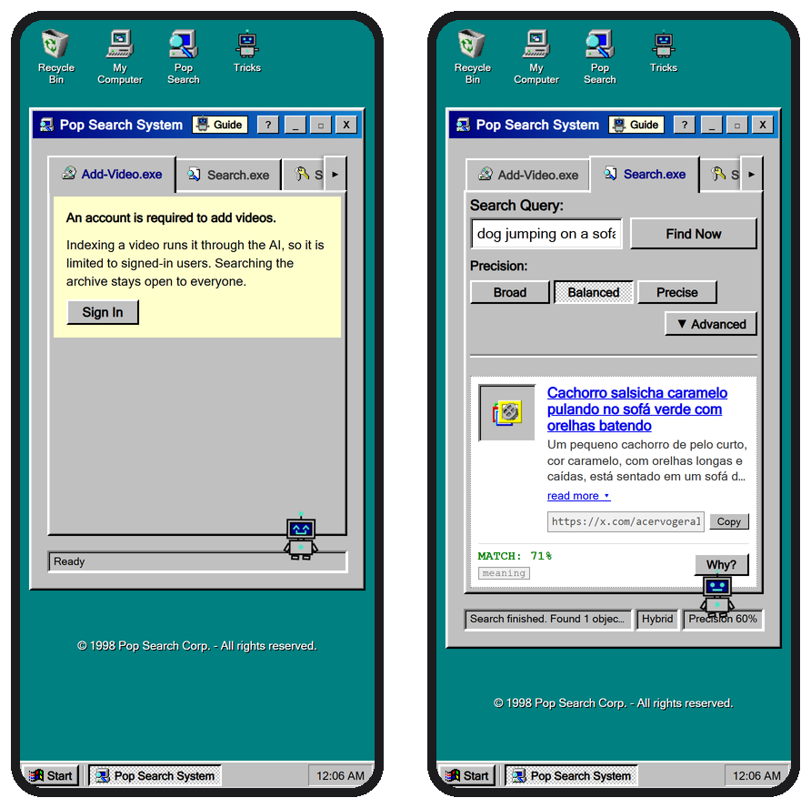

Same desktop, laid out for a little screen.

**In two languages.** The whole interface exists in English and Portuguese, from two typed dictionaries. The Portuguese one has the type of the English one, so a key missing from either does not compile.

<details>
<summary><strong>Secrets and easter eggs (spoilers)</strong></summary>

<br>

Try these before reading on. The `Tricks` icon lists most of them, as things to try rather than what happens.

#### The Recycle Bin, from the inside

Throw `My Computer` or `Tricks` in the bin and open it. The robot goes in after them:

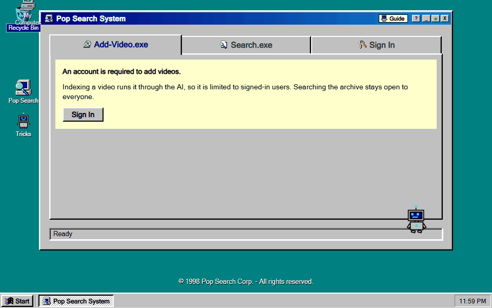

Inside is a Disk Defragmenter left running for decades. Two old games, Flappy BIP and Dino BIP, get it going again: the bar fills with your points and the rescue is ready at the goal.

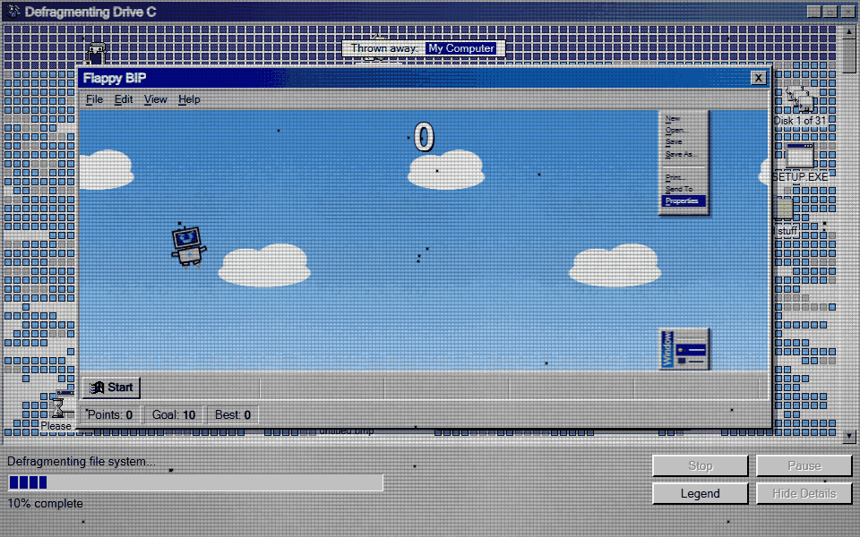

Close the game after the goal and the robot cleans up: it closes every error by its own button, sweeps the wear off the screen and lines the files up.

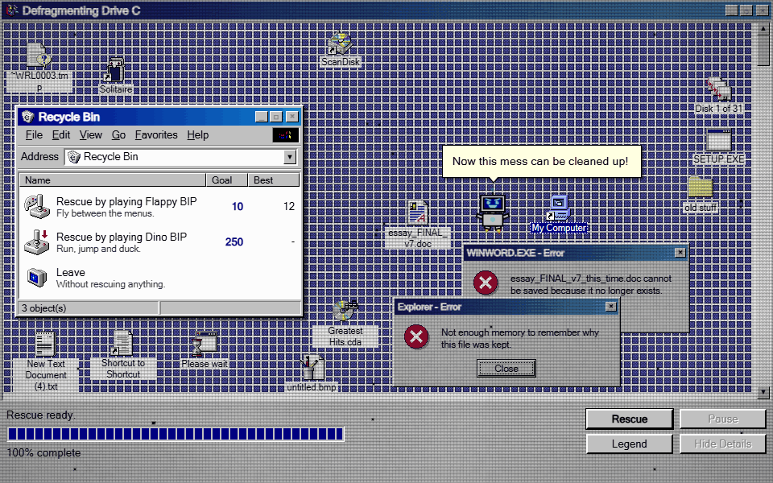

Best scores are kept in the account when signed in, and in the browser otherwise. On a phone, a tap anywhere under the game plays.

#### The rest

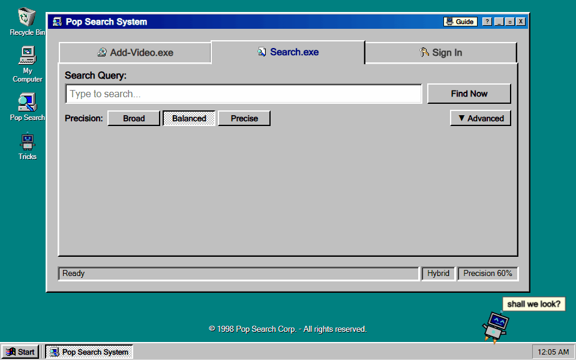

- Search for `c:\con\con`. It brought Windows 98 down, and it does the same here. A key restarts through a boot screen where every line is a real check (session, server).
- Drag the `Pop Search` icon into the Recycle Bin. The robot does not take it well, and builds the whole desktop again.
- Click the window's `X` several times. It is stubborn.
- Poke the robot, drag it, shake it, drop it on the clock, on `Start`, on an icon or on the window's `X`. It has an opinion about each.
- Type `cat`, `dog`, `robot` or `trash` into the search (`gato`, `cachorro`, `robô` or `lixo` with the interface in Portuguese), or SHOUT, and watch the robot while you type.
- Type a password when signing in. It promises not to look.
- Leave the page alone. Among other things, the robot counts the icons, plays hide and seek behind the window, poses as its own portrait on the `Tricks` icon, turns into a screen saver and dials up to the internet. After a long while, it falls asleep.
- Press the `?` on the window, then click anything: the robot flies over and explains it.

</details>

## How search works

Each video is stored twice: as a 768-dimension embedding of what the AI wrote (its meaning) and as a weighted `tsvector` of the same text (its words). A search queries both and merges them with Reciprocal Rank Fusion, which combines the *positions* in each ranking. It works that way because cosine similarity (0 to 1) and `ts_rank_cd` (unbounded) are on different scales and cannot be added.

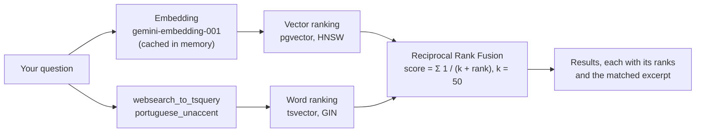

| Mode | How a video gets in |
|---|---|
| `hybrid` (default) | By meaning **or** by exact words |
| `semantic` | By meaning only, above the similarity threshold |
| `text` | By exact words only; the threshold does not apply |

The threshold only filters the vector branch, so a video that contains the exact words comes up at any threshold. The word branch accepts `"exact phrases"`, `-exclusions` and `a or b`, and ignores accents on both sides (`musica` finds `música`). The whole search is one SQL function, `match_videos`, in [`backend/schema.sql`](backend/schema.sql).

## Architecture

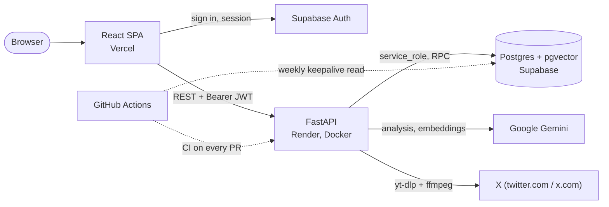

| Layer | Stack |
|---|---|
| Frontend | React 19, TypeScript, Vite, TanStack Query, React Hook Form + Zod, CSS Modules, Vitest + Testing Library |
| Backend | Python 3.12, FastAPI, Pydantic, SlowAPI (rate limits), PyJWT, yt-dlp, ffmpeg, pytest |
| Data and auth | Supabase: Postgres with pgvector (HNSW) and full-text search (GIN), Row Level Security, Supabase Auth |
| AI | Gemini 2.5 Flash watches the video and writes its metadata; `gemini-embedding-001` turns text into 768-dimension vectors |
| Hosting and CI | Vercel (static frontend), Render (backend container), GitHub Actions (lint, build and tests for both halves; a weekly read that keeps the free database awake) |

### Decisions and trade-offs

- **One service.** A single FastAPI service does everything. With no separate queue or worker, there is one less piece to host and look after. An analysis runs as an `asyncio` task in that same process, and its state lives in Postgres (`analysis_jobs`), so the page can be closed and reopened while it runs. One analysis per account is enforced in the database by an atomic `reserve_analysis` function, not in Python. The cost: restarting the server stops the analyses running on it. They are marked as interrupted after ten minutes and do not count against the quota.
- **Rank fusion instead of a weighted sum.** The two rankings are merged by position (RRF, `k = 50`) inside a single SQL function, so the API makes one database call per search and every result can say exactly why it came up. The cost: the fusion only looks at positions and drops how much better one result is than another. First and second place sit the same distance apart whether they are nearly tied or far apart, and `k` is a fixed value.
- **A person reviews before anything is indexed.** The AI drafts title, description, people, scenery and transcript; a person edits them before saving. Manual entry, without AI, is also possible. The cost: every video needs someone's time, so the archive grows slowly.
- **Writes only through the backend.** The `videos` table has no write policy for signed-in users. Every insert goes through the API with the `service_role` key, which is where the quota is checked. The JWT is verified locally with the project's secret, without a call to Supabase on each request. The cost: `service_role` bypasses Row Level Security, so every backend query has to filter by owner itself, without the database as a safety net. And local verification does not check revocation: a token stays valid until it expires, even after the person signs out.
- **A cache in front of the AI.** Question embeddings are kept in memory (up to 256), so a repeated question does not go back to Gemini while the same server stays up. The Performance tab shows it as an AI step of under a millisecond. The cost: the cache is emptied when the server restarts or sleeps, and it is not shared between instances.
- **A robot engine with no libraries.** BIP-98 is an inline SVG driven by a `requestAnimationFrame` state machine (`pilot.ts`), CSS poses switched by data attributes and the Web Animations API. There is no animation, component or state library beyond TanStack Query. The cost: thousands of hand-written lines to maintain, and the automated tests cover what the robot decides to do, not how the motion looks on screen, which is checked by eye.
- **No migration tool.** [`backend/schema.sql`](backend/schema.sql) builds a fresh database from nothing; changes to an existing one are one-off SQL files in [`backend/migrations`](backend/migrations), applied by hand in the Supabase SQL editor. The cost: the deploy order is manual. When the backend depends on a database change, the SQL has to be applied first, and nothing stops anyone from forgetting.

### Known limitations

- **AI quota.** The Gemini free tier allows few analyses a day. Besides each account's monthly limit there is a project-wide daily cap (`DAILY_ANALYSIS_LIMIT`).
- **Downloads from X.** X can block datacenter IP ranges, so an analysis may fail when hosted even when it works locally. Search, the archive and manual entry do not depend on downloads.
- **One process.** Rate limits are kept in memory per instance, and running analyses do not survive a restart. Fine for one instance; scaling out would need a shared store and a job queue.
- **Small gaps.** An account's video list returns up to 200 entries, without pagination, for now.
- **Mocked integrations in tests.** The test suites mock Supabase, Gemini and X, so a green build does not prove those services are reachable.

## Run it locally

To just use it, there is nothing to install: the [app online](https://pop-search-ochre.vercel.app/) runs the same code as `main`. To run your own copy:

### Requirements

- Python 3.10+ (the container and CI use 3.12)
- Node.js 22.12+
- ffmpeg on the `PATH`, only for analysing videos (`winget install --id Gyan.FFmpeg --exact`, `brew install ffmpeg` or `sudo apt-get install ffmpeg`)
- A Supabase project
- A Gemini API key from [Google AI Studio](https://aistudio.google.com)

### 1. Database

In the Supabase **SQL Editor**, run [`backend/schema.sql`](backend/schema.sql). It creates everything it needs: extensions, the accent-insensitive search configuration, tables, indexes, Row Level Security and the search and reservation functions.

Policies created:

```sql
select tablename, policyname, cmd
from pg_policies
where schemaname = 'public'
order by tablename;
```

Only `SELECT` policies should exist. There is no write policy on `videos` on purpose: it stops a signed-in user from inserting directly from the browser and skipping the quota check in the backend.

### 2. Supabase Auth

1. **Authentication → Providers → Email**: enable it. Turning off *Confirm email* makes development easier.
2. **Authentication → URL Configuration**: set `Site URL` to `http://localhost:5173`.
3. **Settings → API Keys**: copy the `anon` key and the `service_role` key.
4. **Settings → JWT Keys**: copy the JWT secret.

To make your account an admin after creating it in the app (it unlocks the `Stats.exe` tab):

```sql
update profiles set is_admin = true where id = '<your-uuid>';
```

### 3. Environment variables

`backend/.env`, from [`backend/.env.example`](backend/.env.example):

| Variable | What it is |
|---|---|
| `SUPABASE_URL` | Your project URL |
| `SUPABASE_SERVICE_KEY` | The `service_role` key. Server only: it bypasses every security rule in the database |
| `SUPABASE_JWT_SECRET` | The JWT secret, used to verify session tokens locally |
| `GEMINI_API_KEY` | Your Gemini API key |
| `LOG_LEVEL` | `DEBUG` in development, `INFO` in production |
| `CORS_ORIGINS` | The frontend origin, `http://localhost:5173` in development, no trailing slash |
| `DAILY_ANALYSIS_LIMIT` | Analyses per day for the whole project, all accounts together. Set it from your real Gemini quota |

`frontend/.env`, from [`frontend/.env.example`](frontend/.env.example):

| Variable | What it is |
|---|---|
| `VITE_SUPABASE_URL` | Your project URL |
| `VITE_SUPABASE_ANON_KEY` | The `anon` key |
| `VITE_API_URL` | The backend URL. Leave it out in development: the Vite dev server proxies `/api` to `http://127.0.0.1:8000`. Required for a production build |

### 4. Run

Backend, in one terminal:

```bash
cd backend
python -m venv venv
source venv/bin/activate        # Windows: .\venv\Scripts\activate
pip install -r requirements-dev.txt
uvicorn main:app --reload
```

Frontend, in another:

```bash
cd frontend
npm install
npm run dev
```

Open `http://localhost:5173`. The API's interactive documentation is at `http://localhost:8000/docs`.

### Scripts, tests and CI

| Where | Command | What it does |
|---|---|---|
| `frontend` | `npm run dev` | Development server with the `/api` proxy |
| `frontend` | `npm run build` | Type check and production build into `dist/` |
| `frontend` | `npm run lint` | ESLint |
| `frontend` | `npm run test -- --run` | The Vitest suite, once |
| `frontend` | `npm run preview` | Serves the production build locally |
| `backend` | `python -m pytest -q` | The pytest suite |

CI runs on every pull request and push to `main`: the backend suite with **fake credentials**, and lint, build and tests on the frontend. Run the backend suite the same way before opening a pull request, because a test that forgets to mock Supabase passes with a real `.env` and fails in CI:

```bash
SUPABASE_URL="https://fake.supabase.co" SUPABASE_KEY="fake-key" \
SUPABASE_SERVICE_KEY="" SUPABASE_JWT_SECRET="" GEMINI_API_KEY="fake-key" \
python -m pytest -q
```

A guard in `conftest.py` turns that mistake into a failure with a message instead of a network call.

## Deployment

The frontend is a static build on Vercel. The backend runs in a Docker container on Render, and the [`Dockerfile`](backend/Dockerfile) installs ffmpeg, because yt-dlp falls back to HLS streams when downloading from X. The database and sign-in live on Supabase. A GitHub Actions workflow ([`supabase-keepalive.yml`](.github/workflows/supabase-keepalive.yml)) reads one row from the database every week, because Supabase pauses free projects after a week without activity.

**Lessons from the deploy**

- `VITE_` variables are fixed at build time: changing one needs a new deploy, not just a restart.
- The backend's CORS has to point at the frontend's domain, with no trailing slash.
- Supabase needs the production domain in `Redirect URLs`, or the confirmation email sends people to `localhost`.

<details>
<summary><strong>API</strong></summary>

<br>

Authenticated routes expect `Authorization: Bearer <access_token>`, the Supabase Auth session token. Limits are per IP.

| Route | Auth | What it does | Limit |
|---|---|---|---|
| `GET /` | | Health check | |
| `GET /system` | | What the server is made of and how it is doing; never calls the AI | 30/min |
| `POST /search` | | Hybrid, semantic or text search; each result carries its ranks, `fusion_k` and the matched excerpt, and the response a `Server-Timing` header | 20/min |
| `POST /videos/analyze` | yes | Starts an analysis (202) of a `twitter.com` or `x.com` link; one at a time per account | 5/min |
| `GET /videos/analyze` | yes | The account's analysis: its stage, then its result or error | 120/min |
| `DELETE /videos/analyze` | yes | Cancels the running analysis or discards the finished one | 30/min |
| `POST /videos/post` | yes | The thumbnail and text of the post behind a link | 20/min |
| `POST /videos` | yes | Indexes a reviewed video | 10/min |
| `GET /me/quota` | yes | Analyses used and left this month | 60/min |
| `GET /me/videos` | yes | The account's own videos | 30/min |
| `PUT /me/videos/{id}` | yes | Corrects one of them and rebuilds its embedding | 20/min |
| `DELETE /me/videos/{id}` | yes | Removes one of them from the archive | 20/min |
| `GET`, `PUT /me/bin-records` | yes | Best scores in the bin's games; a record only goes up | 30/min |
| `GET /me/is-admin`, `/me/all-usage`, `/me/admin/stats` | admin | Usage and cost statistics | 30 to 60/min |

</details>

## Project structure

```
backend/
├── main.py               FastAPI app, CORS, rate limiting
├── schema.sql            The database from nothing
├── migrations/           One-off SQL for existing databases
├── core/                 Auth (JWT), Gemini setup, limiter, logging
├── routers/              health, search, videos, me
├── services/             AI prompt, embeddings, downloads, jobs, quota
└── tests/
frontend/src/
├── components/           One folder per component, with its CSS Module
│   ├── Assistant/        BIP-98: drawing, flight, trips, speech
│   ├── Bin/              The Recycle Bin, the defragmenter and the games
│   └── ...
├── hooks/                Queries, the guide, what the robot says and when
├── context/              Session, status bar and the robot's voice
├── i18n/                 English and Portuguese dictionaries
├── services/api.ts       HTTP client that attaches the session token
└── lib/supabase.ts       Supabase client, for auth only
docs/
├── media/                The images and GIFs of the English README
│   └── pt-BR/            The same, with the interface in Portuguese
└── social-preview.png
```

## Credits

The Windows 98 icons come from [win98icons.alexmeub.com](https://win98icons.alexmeub.com).

## Author

**Guilherme Lavrador Viana** · [GitHub](https://github.com/GLavrador) · [LinkedIn](https://www.linkedin.com/in/guilherme-lviana)
