<div align="center">

[English](README.md) | **Português**

# Pop Search

**Encontre vídeos do X pelo que você lembra deles, numa área de trabalho do Windows 98 com um robô morando nela.**

[](https://github.com/GLavrador/pop-search/actions/workflows/ci.yml)


<a href="https://pop-search-ochre.vercel.app/"></a>

<br><br>

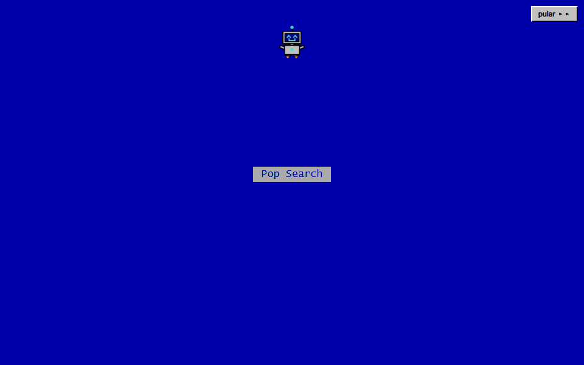

<sub>A primeira visita em cada aba: o BIP-98 monta a área de trabalho na sua frente e abre o programa. Acelerado 1,5x.</sub>

</div>

## O que é

Você viu um vídeo no X faz tempo. Lembra de um cachorro pulando num sofá verde, não das palavras do post. O Pop Search guarda um acervo de vídeos em que uma IA assistiu a cada um e escreveu o que acontece nele, e busca nesse acervo pelo significado e pelas palavras exatas ao mesmo tempo.

Tudo roda dentro de uma área de trabalho do Windows 98. O guia, a ajuda, os erros e os easter eggs passam pelo BIP-98, um robozinho que mora ali: ele explica qualquer controle que você apontar, reage ao que você faz e arruma o que fazer sozinho quando você para de usar o site.

## Experimente

O Pop Search está no ar em **[pop-search-ochre.vercel.app](https://pop-search-ochre.vercel.app/)**, e é o mesmo app que eu uso no dia a dia. Não precisa instalar nada.

- **A primeira visita em cada aba** começa com o robô montando a área de trabalho, uns 20 segundos. Qualquer tecla ou o botão `pular ▸▸` vai direto para o programa.
- **Buscar não precisa de conta.** Abra o `Search.exe`, descreva o vídeo do seu jeito, em português ou em inglês, e clique em `Buscar`.
- **Adicionar vídeos precisa de conta** (a análise por IA consome cota). Dá para criar uma na aba `Sign In`. Cada conta tem um limite mensal de análises.
- **Não sabe por onde começar?** Aceite o convite do guia, acima das abas. Ele mostra como adicionar e encontrar um vídeo em telas de treino, sem conta e sem chamar a IA.
- **Depois, explore.** Dê dois cliques no ícone `Truques` para ver a lista do próprio robô com o que tentar, e deixe a página quieta por um tempinho para ver o que ele traquina.
- **A interface segue o idioma do navegador**, em português ou em inglês, e troca na aba `Sign In`. As imagens daqui estão em português.

## Funcionalidades

### Um guia que usa as telas de verdade

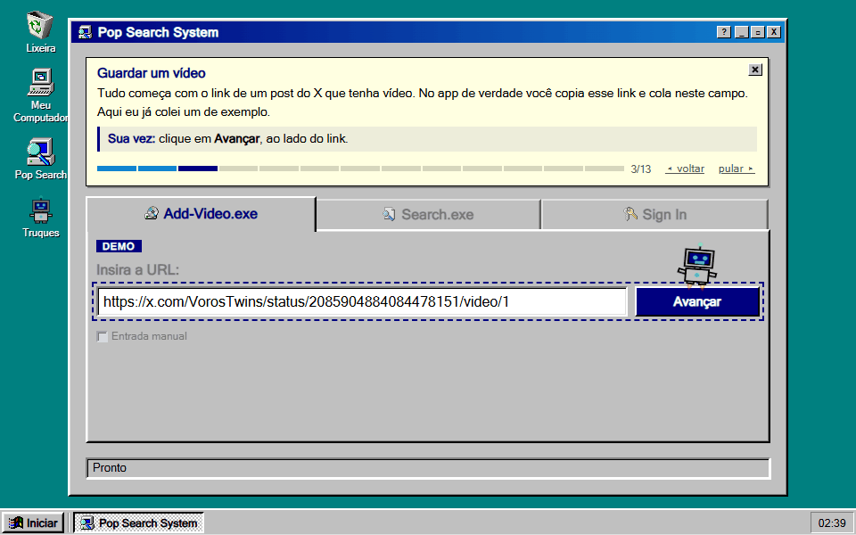

O guia roda por cima da própria interface, com dados de treino: colar o link, escolher o que a IA deve observar, acompanhar a análise, revisar o que ela escreveu e salvar. Nada vai pro acervo antes de uma pessoa ler e editar. Acelerado 2x.

### Busca pelo que você lembra

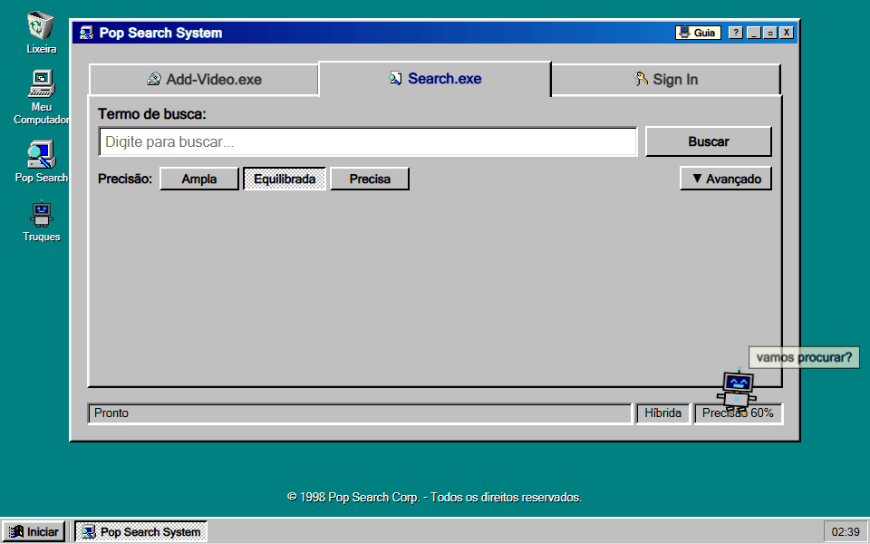

A pergunta está em inglês e a descrição do vídeo, em português: nenhuma palavra em comum, e mesmo assim ele aparece em primeiro. Todo resultado tem um botão `Por quê?` que explica em palavras simples em que lugar ele ficou pelo significado e pelas palavras, e que trecho do texto bateu.

### Adicionar um vídeo

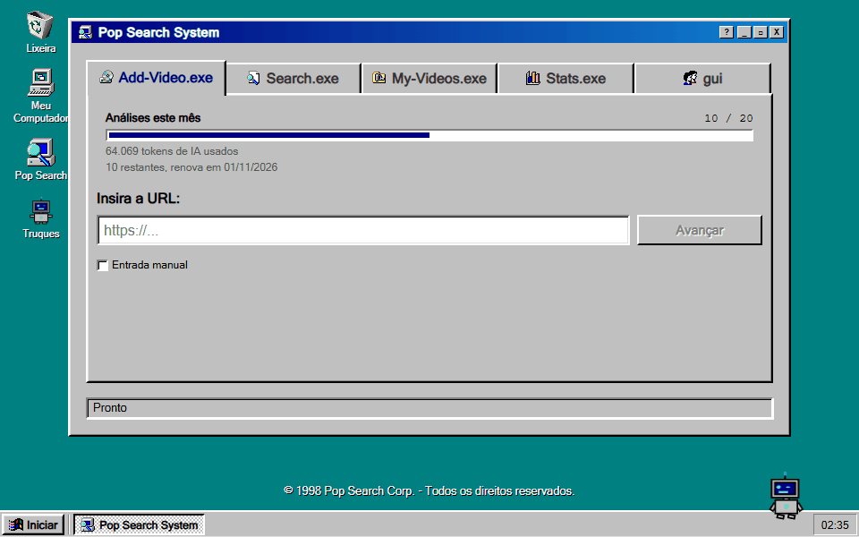

Com conta, um vídeo entra no acervo de dois jeitos: pela análise da IA, que assiste e escreve um rascunho para a pessoa revisar, como no guia, ou à mão, marcando `Entrada manual`. No GIF, o cadastro à mão: o link do post, `Abrir formulário`, título e descrição, e `Salvar`. A entrada manual não gasta análise da cota; só o embedding do texto passa pelo Gemini. Acelerado 1,4x.

### Um robô com vida própria

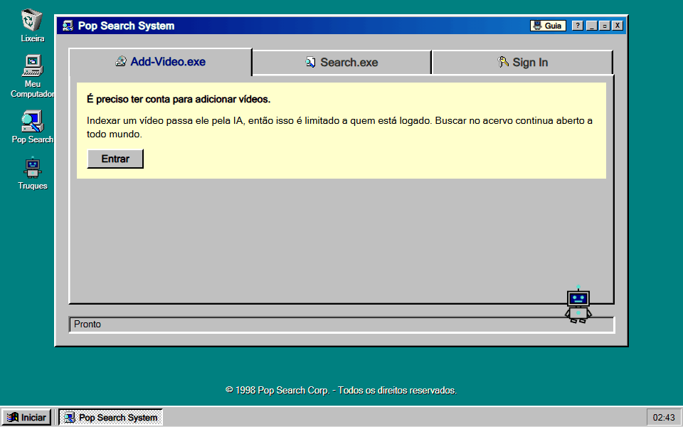

Entre um clique e outro, o BIP-98 descansa em cima da janela, na barra de tarefas ou na barra de status. Sozinho, ele passa por uma série de pequenas cenas, como bater no vidro da tela, e nunca enquanto alguém digita, mexe no mouse ou está com uma janela aberta.

### O Meu Computador mostra a máquina de verdade

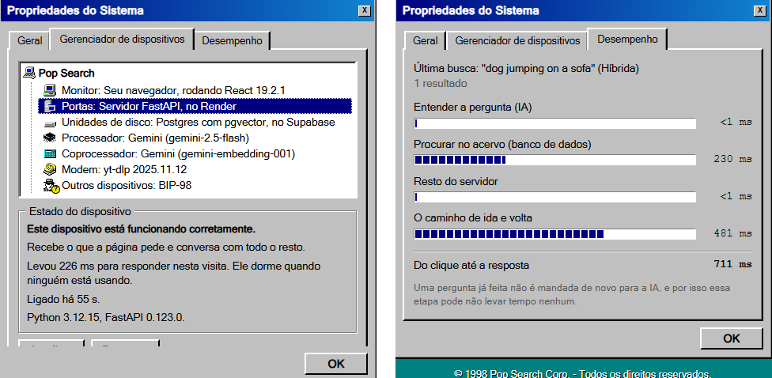

O `Meu Computador` abre as Propriedades do Sistema. O Gerenciador de dispositivos lista as peças de que o app é feito de verdade, com o estado atual vindo do servidor, e a aba Desempenho divide a última busca em etapas, cronometradas pelo servidor no cabeçalho `Server-Timing`.

### No celular

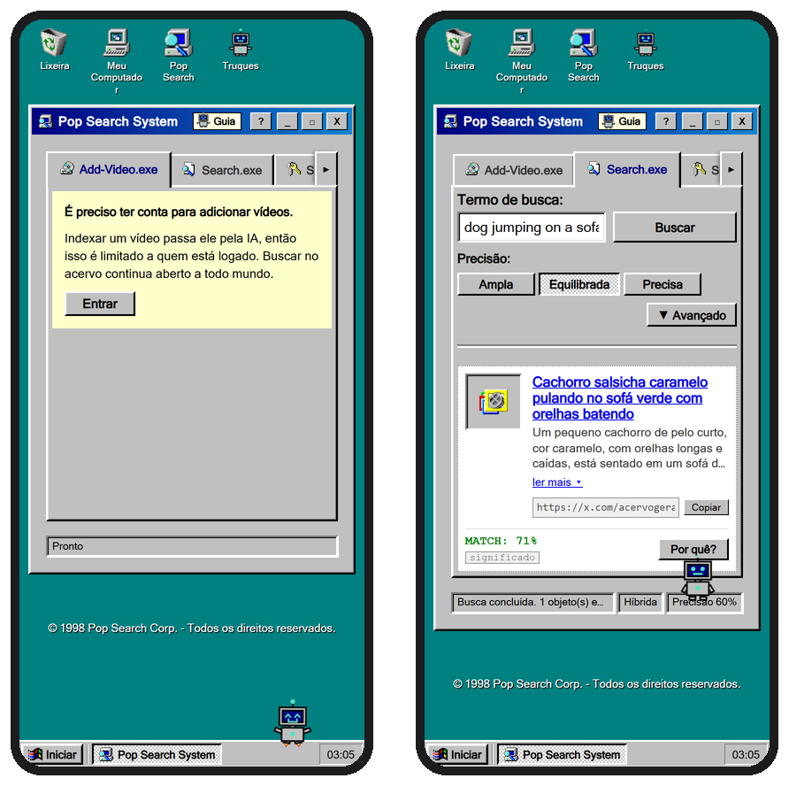

A mesma área de trabalho, arrumada para a telinha.

**Em duas línguas.** A interface é inteira em inglês e em português, a partir de dois dicionários tipados. O dicionário em português tem o tipo do inglês, então uma chave que falte em qualquer um dos dois não compila.

<details>
<summary><strong>Segredos e easter eggs (spoilers)</strong></summary>

<br>

Tente antes de ler. O ícone `Truques` lista a maioria, como coisas a tentar e não como o que acontece.

#### A Lixeira, por dentro

Jogue o `Meu Computador` ou os `Truques` na Lixeira e abra-a. O robô vai atrás:

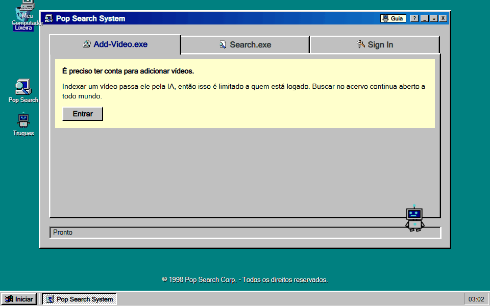

Lá dentro há um Desfragmentador de disco esquecido há décadas. Dois jogos antigos, Flappy BIP e Dino BIP, fazem ele andar de novo: a barra enche com os pontos e o resgate fica pronto na meta.

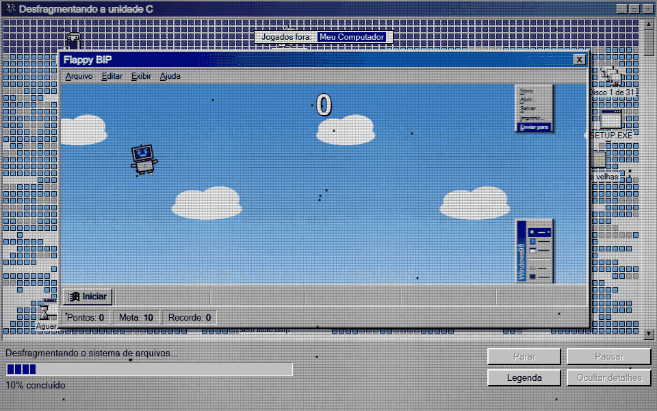

Feche o jogo depois da meta e o robô faz a faxina: fecha cada erro pelo próprio botão, varre o desgaste da tela e alinha os arquivos.

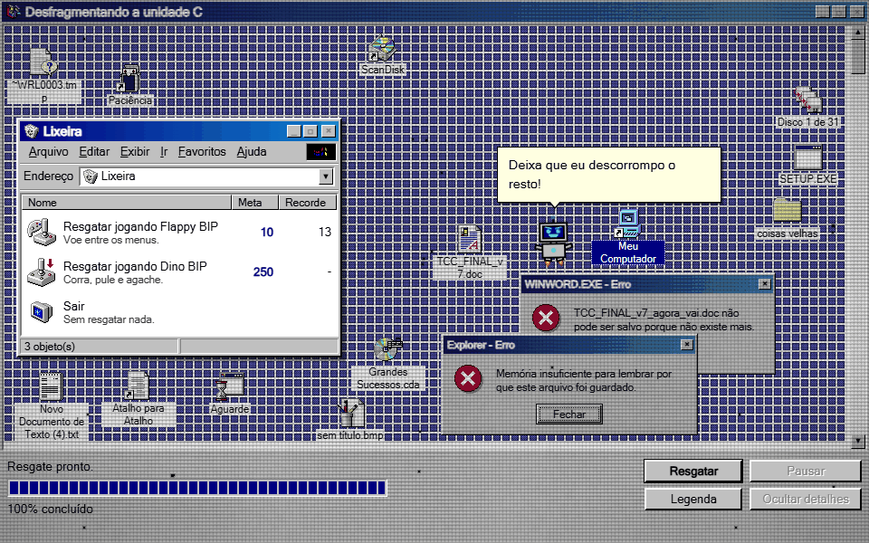

O recorde fica na conta de quem está logado e, sem conta, no navegador. No celular, um toque em qualquer lugar abaixo do jogo já joga.

#### O resto

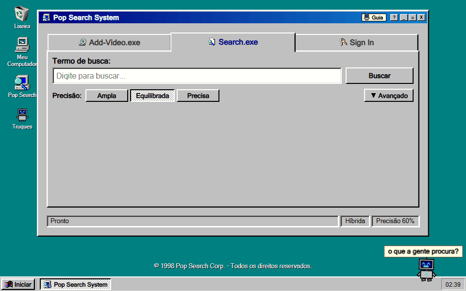

- Busque `c:\con\con`. Isso derrubava o Windows 98, e aqui também derruba. Uma tecla reinicia pela tela de boot, em que cada linha é uma verificação de verdade (sessão, servidor).
- Arraste o ícone do `Pop Search` para a Lixeira. O robô não aceita bem e reconstrói a área de trabalho inteira.
- Clique várias vezes no `X` da janela. Ela é teimosa.
- Cutuque o robô, arraste, sacuda, solte em cima do relógio, do `Iniciar`, de um ícone ou do `X` da janela. Ele tem uma opinião sobre cada um.
- Escreva `gato`, `cachorro`, `robô` ou `lixo` na busca (`cat`, `dog`, `robot` ou `trash` com a interface em inglês), ou GRITE, e repare no robô enquanto digita.
- Digite uma senha na hora de entrar na conta. Ele jura que não olha.
- Deixe a página quieta. Entre outras coisas, o robô conta os ícones, brinca de esconde-esconde atrás da janela, imita o próprio retrato no ícone `Truques`, vira proteção de tela e disca para a internet. Depois de muito tempo, dorme.
- Aperte o `?` da janela e clique em qualquer coisa: o robô voa até lá e explica.

</details>

## Como a busca funciona

Cada vídeo é guardado duas vezes: como um embedding de 768 dimensões do que a IA escreveu (o significado) e como um `tsvector` com pesos sobre o mesmo texto (as palavras). A busca consulta os dois e funde os resultados com Reciprocal Rank Fusion, que combina as *posições* em cada ranking. É desse jeito porque a similaridade de cosseno (de 0 a 1) e o `ts_rank_cd` (sem limite) estão em escalas diferentes e não dá para somar.

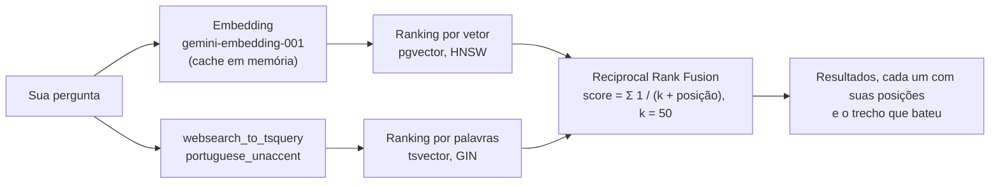

| Modo | Como um vídeo entra no resultado |
|---|---|
| `hybrid` (padrão) | Pelo significado **ou** pelas palavras exatas |
| `semantic` | Só pelo significado, acima do limiar de similaridade |
| `text` | Só pelas palavras exatas; o limiar não se aplica |

O limiar só filtra o ramo vetorial, então um vídeo que contém as palavras buscadas aparece em qualquer limiar. O ramo de palavras aceita `"frase exata"`, `-excluir` e `a or b`, e ignora acentos dos dois lados (`musica` encontra `música`). A busca inteira é uma função SQL, a `match_videos`, em [`backend/schema.sql`](backend/schema.sql).

## Arquitetura

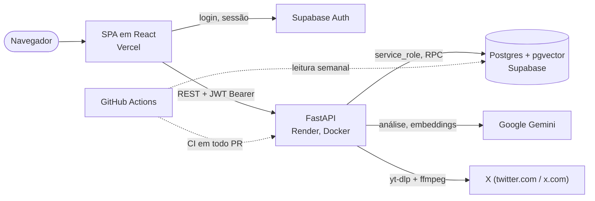

| Camada | Stack |
|---|---|
| Frontend | React 19, TypeScript, Vite, TanStack Query, React Hook Form + Zod, CSS Modules, Vitest + Testing Library |
| Backend | Python 3.12, FastAPI, Pydantic, SlowAPI (limite de requisições), PyJWT, yt-dlp, ffmpeg, pytest |
| Dados e autenticação | Supabase: Postgres com pgvector (HNSW) e busca textual (GIN), Row Level Security, Supabase Auth |
| IA | O Gemini 2.5 Flash assiste ao vídeo e escreve os metadados; o `gemini-embedding-001` transforma texto em vetores de 768 dimensões |
| Hospedagem e CI | Vercel (frontend estático), Render (container do backend), GitHub Actions (lint, build e testes das duas metades; uma leitura semanal que mantém o banco gratuito acordado) |

### Decisões e trade-offs

- **Um serviço só.** Um único serviço FastAPI faz tudo. Sem fila nem worker à parte, há uma peça a menos para hospedar e manter. A análise roda como uma tarefa `asyncio` no mesmo processo, e o estado dela fica no Postgres (`analysis_jobs`), então dá para fechar a página e voltar enquanto ela anda. A regra de uma análise por conta é assegurada no banco, por uma função atômica (`reserve_analysis`), e não no Python. O preço: reiniciar o servidor interrompe as análises que estavam rodando nele. Elas são marcadas como interrompidas depois de dez minutos e não contam na cota.
- **Fusão por posição em vez de soma com pesos.** Os dois rankings são fundidos pela posição (RRF, `k = 50`) dentro de uma única função SQL, então a API faz uma chamada ao banco por busca e cada resultado consegue dizer exatamente por que apareceu. O preço: a fusão olha só a posição e descarta o quanto um resultado é melhor que o outro. O primeiro e o segundo lugar ficam à mesma distância, estejam quase empatados ou muito longe, e o `k` é um valor fixo.
- **Uma pessoa revisa antes de indexar.** A IA rascunha título, descrição, pessoas, cenário e transcrição; uma pessoa edita antes de salvar. Também dá para cadastrar à mão, sem IA. O preço: todo vídeo depende do tempo de alguém, então o acervo cresce devagar.
- **Escrita só pelo backend.** A tabela `videos` não tem política de escrita para usuários logados. Toda inserção passa pela API com a chave `service_role`, que é onde a cota é conferida. O JWT é validado localmente com o segredo do projeto, sem consultar o Supabase a cada requisição. O preço: a `service_role` ignora o Row Level Security, então cada consulta do backend precisa filtrar pelo dono por conta própria, sem a proteção do banco por trás. E a validação local não consulta revogação: um token continua valendo até expirar, mesmo depois de a pessoa sair da conta.
- **Um cache na frente da IA.** Os embeddings das perguntas ficam em memória (até 256), então uma pergunta repetida não volta ao Gemini enquanto o mesmo servidor estiver de pé. A aba Desempenho mostra isso como uma etapa de IA de menos de um milissegundo. O preço: o cache zera quando o servidor reinicia ou dorme, e não é compartilhado entre instâncias.
- **Um motor de robô sem bibliotecas.** O BIP-98 é um SVG desenhado no próprio código e movido por uma máquina de estados em `requestAnimationFrame` (`pilot.ts`), poses em CSS trocadas por atributos e a Web Animations API. Não há biblioteca de animação, de componentes nem de estado além do TanStack Query. O preço: são milhares de linhas escritas à mão para manter, e os testes automatizados cobrem o que o robô decide fazer, não como o movimento fica na tela, que é conferido no olho.
- **Sem ferramenta de migração.** O [`backend/schema.sql`](backend/schema.sql) monta um banco novo do zero; mudanças num banco existente são arquivos SQL avulsos em [`backend/migrations`](backend/migrations), aplicados à mão no editor SQL do Supabase. O preço: a ordem do deploy é manual. Quando o backend depende de uma mudança no banco, o SQL tem que ser aplicado antes, e nada impede de esquecer.

### Limitações conhecidas

- **Cota de IA.** O plano gratuito do Gemini permite poucas análises por dia. Além do limite mensal de cada conta, existe um teto diário do projeto inteiro (`DAILY_ANALYSIS_LIMIT`).
- **Downloads do X.** O X pode bloquear faixas de IP de datacenter, então uma análise pode falhar hospedada mesmo funcionando localmente. A busca, o acervo e o cadastro manual não dependem de download.
- **Um processo só.** Os limites de requisição ficam em memória, por instância, e as análises em andamento não sobrevivem se reiniciar. Serve bem para uma instância; escalar exigiria um armazenamento compartilhado e uma fila de tarefas.
- **Pequenas faltas.** A lista de vídeos de uma conta traz até 200 itens, sem paginação, por enquanto.
- **Integrações simuladas nos testes.** As suítes simulam Supabase, Gemini e X, então um build verde não prova que esses serviços estão acessíveis.

## Como rodar

Para só usar, não precisa instalar nada: o [app no ar](https://pop-search-ochre.vercel.app/) roda o mesmo código da `main`. Para ter a sua cópia:

### Requisitos

- Python 3.10+ (o container e a CI usam 3.12)
- Node.js 22.12+
- ffmpeg no `PATH`, só para analisar vídeos (`winget install --id Gyan.FFmpeg --exact`, `brew install ffmpeg` ou `sudo apt-get install ffmpeg`)
- Um projeto no Supabase
- Uma chave da API do Gemini, do [Google AI Studio](https://aistudio.google.com)

### 1. Banco de dados

No **SQL Editor** do Supabase, execute o [`backend/schema.sql`](backend/schema.sql). Ele cria tudo que precisa, as extensões, a configuração de busca sem acentos, tabelas, índices, Row Level Security e as funções de busca e de reserva.

Políticas criadas:

```sql
select tablename, policyname, cmd
from pg_policies
where schemaname = 'public'
order by tablename;
```

Devem existir só políticas de `SELECT`. Não existe política de escrita em `videos` de propósito, pois impede que um usuário logado insira direto pelo navegador e pule a conferência de cota no backend.

### 2. Supabase Auth

1. **Authentication → Providers → Email**: habilite. Desligar o *Confirm email* facilita o desenvolvimento.
2. **Authentication → URL Configuration**: `Site URL` = `http://localhost:5173`.
3. **Settings → API Keys**: copie a chave `anon` e a `service_role`.
4. **Settings → JWT Keys**: copie o segredo do JWT.

Para tornar sua conta administradora depois de criá-la pelo app (isso libera a aba `Stats.exe`):

```sql
update profiles set is_admin = true where id = '<seu-uuid>';
```

### 3. Variáveis de ambiente

`backend/.env`, a partir do [`backend/.env.example`](backend/.env.example):

| Variável | O que é |
|---|---|
| `SUPABASE_URL` | A URL do seu projeto |
| `SUPABASE_SERVICE_KEY` | A chave `service_role`. Só no servidor: ela ignora todas as regras de segurança do banco |
| `SUPABASE_JWT_SECRET` | O segredo do JWT, usado para validar as sessões localmente |
| `GEMINI_API_KEY` | Sua chave da API do Gemini |
| `LOG_LEVEL` | `DEBUG` em desenvolvimento, `INFO` em produção |
| `CORS_ORIGINS` | A origem do frontend, `http://localhost:5173` em desenvolvimento, sem barra no final |
| `DAILY_ANALYSIS_LIMIT` | Análises por dia no projeto inteiro, somando todas as contas. Ajuste pela sua cota real do Gemini |

`frontend/.env`, a partir do [`frontend/.env.example`](frontend/.env.example):

| Variável | O que é |
|---|---|
| `VITE_SUPABASE_URL` | A URL do seu projeto |
| `VITE_SUPABASE_ANON_KEY` | A chave `anon` |
| `VITE_API_URL` | A URL do backend. Deixe de fora em desenvolvimento: o servidor do Vite encaminha `/api` para `http://127.0.0.1:8000`. Obrigatória no build de produção |

### 4. Rodar

O backend, num terminal:

```bash
cd backend
python -m venv venv
source venv/bin/activate        # Windows: .\venv\Scripts\activate
pip install -r requirements-dev.txt
uvicorn main:app --reload
```

O frontend, em outro:

```bash
cd frontend
npm install
npm run dev
```

Abra `http://localhost:5173`. A documentação interativa da API fica em `http://localhost:8000/docs`.

### Scripts, testes e CI

| Onde | Comando | O que faz |
|---|---|---|
| `frontend` | `npm run dev` | Servidor de desenvolvimento, com o proxy de `/api` |
| `frontend` | `npm run build` | Checagem de tipos e build de produção em `dist/` |
| `frontend` | `npm run lint` | ESLint |
| `frontend` | `npm run test -- --run` | A suíte do Vitest, uma vez |
| `frontend` | `npm run preview` | Serve o build de produção localmente |
| `backend` | `python -m pytest -q` | A suíte do pytest |

A CI roda em todo pull request e em todo push na `main`: a suíte do backend com **credenciais falsas**, e lint, build e testes no frontend. Rode a suíte do backend do mesmo jeito antes de abrir um pull request, porque um teste que esquece de simular o Supabase passa com o `.env` real e quebra na CI:

```bash
SUPABASE_URL="https://fake.supabase.co" SUPABASE_KEY="fake-key" \
SUPABASE_SERVICE_KEY="" SUPABASE_JWT_SECRET="" GEMINI_API_KEY="fake-key" \
python -m pytest -q
```

Uma proteção no `conftest.py` transforma esse erro numa falha com mensagem, em vez de uma chamada de rede.

## Deploy

O frontend é um build estático na Vercel. O backend roda num container Docker no Render, e o [`Dockerfile`](backend/Dockerfile) instala o ffmpeg, porque o yt-dlp cai em streams HLS ao baixar do X. O banco e o login ficam no Supabase. Um workflow do GitHub Actions ([`supabase-keepalive.yml`](.github/workflows/supabase-keepalive.yml)) lê uma linha do banco toda semana, porque o Supabase pausa projetos gratuitos que passam uma semana sem atividade.

**Lições do deploy**

- As variáveis `VITE_` são fixadas no build do frontend: mudar uma exige um novo deploy, não só reiniciar.
- O CORS do backend precisa apontar para o domínio do frontend, sem barra no final.
- O Supabase precisa do domínio de produção em `Redirect URLs`, senão o e-mail de confirmação leva para `localhost`.

<details>
<summary><strong>API</strong></summary>

<br>

As rotas autenticadas esperam `Authorization: Bearer <access_token>`, o token de sessão do Supabase Auth. Os limites são por IP.

| Rota | Conta | O que faz | Limite |
|---|---|---|---|
| `GET /` | | Healthcheck | |
| `GET /system` | | Do que o servidor é feito e como está; nunca chama a IA | 30/min |
| `POST /search` | | Busca híbrida, semântica ou textual; cada resultado traz suas posições, o `fusion_k` e o trecho que bateu, e a resposta, um cabeçalho `Server-Timing` | 20/min |
| `POST /videos/analyze` | sim | Começa a análise (202) de um link de `twitter.com` ou `x.com`; uma por vez por conta | 5/min |
| `GET /videos/analyze` | sim | A análise da conta: a etapa e, no fim, o resultado ou o erro | 120/min |
| `DELETE /videos/analyze` | sim | Cancela a análise em andamento ou descarta a que terminou | 30/min |
| `POST /videos/post` | sim | A miniatura e o texto do post por trás de um link | 20/min |
| `POST /videos` | sim | Indexa um vídeo revisado | 10/min |
| `GET /me/quota` | sim | Análises usadas e restantes no mês | 60/min |
| `GET /me/videos` | sim | Os vídeos da própria conta | 30/min |
| `PUT /me/videos/{id}` | sim | Corrige um deles e refaz o embedding | 20/min |
| `DELETE /me/videos/{id}` | sim | Tira um deles do acervo | 20/min |
| `GET`, `PUT /me/bin-records` | sim | Recordes dos jogos da Lixeira; um recorde só sobe | 30/min |
| `GET /me/is-admin`, `/me/all-usage`, `/me/admin/stats` | admin | Estatísticas de uso e de custo | 30 a 60/min |

</details>

## Estrutura do projeto

```
backend/
├── main.py               App FastAPI, CORS, limite de requisições
├── schema.sql            O banco do zero
├── migrations/           SQL avulso para bancos existentes
├── core/                 Autenticação (JWT), Gemini, limitador, logs
├── routers/              health, search, videos, me
├── services/             Prompt da IA, embeddings, downloads, tarefas, cota
└── tests/
frontend/src/
├── components/           Uma pasta por componente, com seu CSS Module
│   ├── Assistant/        BIP-98: desenho, voo, cenas, falas
│   ├── Bin/              A Lixeira, o desfragmentador e os jogos
│   └── ...
├── hooks/                Queries, o guia, o que o robô diz e quando
├── context/              Sessão, barra de status e a voz do robô
├── i18n/                 Dicionários em inglês e em português
├── services/api.ts       Cliente HTTP que anexa o token da sessão
└── lib/supabase.ts       Cliente do Supabase, só para autenticação
docs/
├── media/                As imagens e os GIFs do README em inglês
│   └── pt-BR/            Os mesmos, com a interface em português
└── social-preview.png
```

## Créditos

Os ícones do Windows 98 vêm de [win98icons.alexmeub.com](https://win98icons.alexmeub.com).

## Autor

**Guilherme Lavrador Viana** · [GitHub](https://github.com/GLavrador) · [LinkedIn](https://www.linkedin.com/in/guilherme-lviana)
